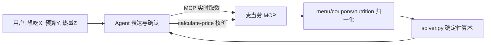

# 🍔 麦门信徒 · mcd-believer

> 一个基于**麦当劳中国官方 MCP** 的 Agent Skill —— 一个技能打通点餐下单、省钱领券、营养配餐、积分商城、积分抽奖、活动日历、主题派对预约，外加口味记忆/年报人设的**全场景麦当劳管家**。算术交给确定性代码，表达交给 Agent。

[](https://github.com/M-China/mcd-developer-innovation-challenge)
[](https://open.mcd.cn/mcp)
[](#-它强在哪覆盖-35-个-mcp-工具)
[](#-30-秒体验不需要-mcp-token)
[](#-30-秒体验不需要-mcp-token)
[](#-确定性内核算术交给代码)
[](LICENSE)

解决每天最难的三个选择题：**吃什么、怎么点最省、积分怎么用不浪费**。参赛 370+ 个项目大多只做一个场景，`mcd-believer` 把麦当劳 MCP 的**全部能力 + 全部高频共识需求**收进一个 Skill。

---

## 🎮 30 秒体验（不需要 MCP Token）

```bash
git clone https://github.com/schalkiii/mcd-believer.git
cd mcd-believer
python demo.py        # 一键跑通五条链路，浏览器打开 demo_output/ 下的两张分享卡
```

**不想装环境？** 在线试算页（浏览器打开即玩，内置构造示例数据）：
<https://schalkiii.github.io/mcd-believer/demo.html>

零第三方依赖、不联网、不需要 Token。`fixtures/` 里是结构对齐 MCP 真实返回的构造样本，求解逻辑与线上完全一致。

## 💡 数字战报（fixtures 构造样本实测）

预算 40 元、热量 ≤800 kcal，求解器枚举 **602 套**候选组合，输出三套方案：

| 方案 | 组合 | 原价 | 用券后实付 |
|---|---|---:|---:|
| 最饱（799 kcal） | 玉米杯(小) + 奥利奥麦旋风 + 薯条(大) | ¥34.00 | **¥22.50**（小食5折省 ¥11.50） |
| 最省 | 甜筒 | ¥6.00 | **¥3.00**（甜品立减3元） |
| 最均衡（每元蛋白最高） | 双层吉士汉堡 | ¥15.50 | **¥10.85**（汉堡7折） |

多人拼单 ¥33.50 ÷ 6 人：**¥5.59 ×2 + ¥5.58 ×4**，合计恰等于实付，零尾差（最大余数法，整数分运算）。

> 以上为构造样本上的算法演示；真实价格一律以 MCP `calculate-price` 核价为准。

## ✨ 它是什么

`mcd-believer` 是一个 **Agent Skill**（`SKILL.md` + 分场景操作手册 + 确定性内核脚本）。在 WorkBuddy / Cursor / Cherry Studio / Trae 等支持 MCP 的客户端里接入麦当劳 MCP 并装载本 Skill，AI 就能按沉淀好的编排规则，替你完成从"想吃"到"拿到取餐码/支付链接"的完整闭环。

- 🧭 **意图路由**：一句话自动分派到点餐 / 省钱 / 营养 / 积分 / 活动 / 派对 / 画像七大手册。
- 🔗 **端到端下单**：选店 → 选品 → 算价 → 下单 → 跟单/取消，含到店、得来速、麦乐送、企业团餐四种场景；另支持**多人拼单零尾差 AA、异地代点、指定预算求解、一句话复购老样子**。
- 💰 **真·省钱但不劝卖**：领券 → 门店可用券 → 满减凑单 → 实测应付；**亏本凑单主动劝退**，券/积分/抽奖机会一张**到期倒计时表**统一盘。
- 🥗 **按热量配餐**：目标热量凑一餐，另带**蛋白质性价比榜、运动后窗口餐、高血压/糖尿病等特殊人群钠糖阈值三档白名单与量化改配**。
- 🎁 **积分管家**：积分余额 + 末班车主动提醒 + 商城兑换 + 周边/玩具类目检索 + 抽奖（严格先确认后抽）。
- 📅 **活动雷达 + 派对预约**：当月活动日历情报、生日/主题派对逐步下单。
- 🪪 **麦门画像**：本地 `mcd-profile.json` 记住你的店/忌口/预算/习饮；用真实订单数据生成**年报人设分享卡**（薯条纯爱党/深夜麦门徒/精算省钱家…）；还有**省心模式**：给视障、开车、长辈的一句话极简输出。

## 🧮 确定性内核：算术交给代码

取数交给 MCP、**算术交给确定性代码**、表达交给 Agent——价格、组合、分账全部由 `scripts/solver.py` 计算，从架构上杜绝模型口算误差：

| 能力 | 实现 | 离线验证 |
|---|---|---|
| 预算 × 热量双约束求解 | 组合枚举 + 累计价格剪枝（完备），输出最饱/最省/最均衡 | `python scripts/solver.py solve --budget 40 --kcal 800` |
| 券组合优化 | 子集枚举，满减/折扣/品类范围/**同组互斥**/**范围不重叠**（保守模型，真实可叠性以 `calculate-price` 为准） | 36 项单元测试 |
| 多人拼单 AA | 最大余数法，整数分运算，分账之和恰等于实付 | `python scripts/solver.py aa --total 33.5 --people 6` |
| 价格 × 热量帕累托前沿 | 非支配解集 | 单元测试覆盖 |
| 年报人设规则 | 确定性规则引擎，同输入必得同结果，不靠大模型猜测 | `derive_persona` 测试 |



## 🖼 分享卡：为截图而设计

`scripts/card.py` 渲染单文件竖屏 HTML（品牌红金配色、零外部链接、移动端优先）：

- **麦门灵签卡**：签文命格 + 餐品清单 + 原价/实付对比 + 用券明细
- **麦门年报人设卡**：周期消费总览 + 本命餐品 TOP3 + 渠道/时段画像 + 人设徽章

```bash
python scripts/card.py    # 生成到 demo_output/，手机打开即可截图分享
```

## 🧩 它强在哪：覆盖 35 个 MCP 工具

比读官方 README（33 个）更全 —— 实测 tools/list 发现两个隐藏工具 `query-survey-coupons`、`query-promotions`，全部纳入编排。

| 场景 | 用到的工具 |
|---|---|
| 点餐交易 | query-nearby-stores · delivery-query-addresses · delivery-create-address · delivery-query-stores · query-meals · query-meal-detail · query-meal-assistance · calculate-price · create-order · query-order · cancel-order · order-list |
| 省钱 | available-coupons · auto-bind-coupons · query-my-coupons · query-store-coupons · query-promotions |
| 营养 | list-nutrition-foods |
| 积分/商城/抽奖 | query-my-account · mall-points-products · mall-product-detail · mall-create-order · mall-order-list · mall-order-detail · query-lottery-info · draw-lottery · query-my-prizes |
| 活动/派对 | now-time-info · campaign-calendar · query-party-city · query-party-store · query-party-store-date · query-party-store-session · party-order-create |
| 售后 | query-survey-coupons |

**榜单空白占位**：全量调研 370 条参赛 Issue 后确认——「端到端交易闭环 + 异地代点」几乎无人完整覆盖（代点类仅个位数），本项目是少数把选店→支付→跟单全链路打通的 Skill。

## 🚀 快速开始

### 1. 申请麦当劳 MCP Token
访问 https://open.mcd.cn/mcp → 手机号登录 → 控制台 → 激活 → 复制 MCP Token。

### 2. 接入 MCP
把 `mcp-config.example.json` 里的 `YOUR_MCP_TOKEN` 换成你的 Token，填入客户端的 MCP 配置：

```json
{
  "mcpServers": {
    "mcd-mcp": {
      "type": "streamablehttp",
      "url": "https://mcp.mcd.cn",
      "headers": { "Authorization": "Bearer YOUR_MCP_TOKEN" }
    }
  }
}
```

### 3. 装载 Skill
把本仓库目录作为 Skill 装载（`SKILL.md` 为入口）。在对话框直接说人话：

- 「帮我在公司附近的麦当劳点份麦乐送，预算 40，不要辣」
- 「我有多少积分？哪些快过期了？能兑什么？」
- 「配一顿 500 大卡以内的麦当劳」
- 「这个月有什么活动？帮我约个生日派对」
- 「今天吃什么？帮我抽一支麦门灵签」
- 「我们 6 个人聚餐预算 240，两人不吃辣，怎么点？」
- 「按老样子来一份」 / 「给我出张麦门年报」

### 4. 真实数据留证（可选）
```bash
export MCD_MCP_TOKEN=你的Token
python scripts/capture_evidence.py   # 只读工具自动脱敏留证到 evidence/
```

## 👥 目标用户

选择困难症患者、麦门信徒、精打细算的打工人、健身党、手握一堆积分不知怎么花的人、要给孩子订生日派对的家长、组织企业团餐的行政、想给异地爸妈点餐的游子、需要极简语音式点餐的视障/开车/长辈用户。

## 📁 项目结构

```
mcd-believer/
├── SKILL.md                     # 技能入口：意图路由 + 全局铁律 + 默认流程
├── references/
│   ├── ordering.md              # 点餐交易全流程（四种场景 + 特调 + 早餐压哨 + 拼单AA/代点/预算求解）
│   ├── savings.md               # 省钱：领券/可用券/满减满折凑单/资产倒计时
│   ├── nutrition.md             # 营养：按热量配餐/健身进阶/特殊人群
│   ├── points-mall.md           # 积分：账户/商城兑换/抽奖/周边检索
│   ├── activities.md            # 活动日历 + 主题派对逐步预约
│   ├── profile.md               # 画像：口味记忆/复购/年报人设卡/省心模式
│   └── tools-reference.md       # 35 工具入参速查表
├── scripts/
│   ├── solver.py                # 确定性求解器：双约束枚举/券优化/AA/帕累托/订单统计
│   ├── card.py                  # 分享卡生成器：灵签卡 + 年报人设卡（单文件 HTML）
│   ├── capture_evidence.py      # 真实 MCP 只读返回脱敏留证
│   └── mcp_call.py              # 纯标准库 MCP JSON-RPC 客户端（兜底）
├── fixtures/                    # 构造样本数据（结构对齐 MCP 返回），demo/测试用
├── tests/                       # 36 项单元测试（solver + card）
├── docs/demo.html               # 在线试算页（免 Token 即玩）
├── demo.py                      # 一键演示入口
├── README.md · MCP_INTEGRATION.md · CONTEST_DECLARATION.md · workbuddy.md
└── mcp-config.example.json
```

## 🔒 安全与合规

- MCP Token 仅存于本地配置/环境变量，**不写死进代码、不提交仓库**。
- 所有下单 / 兑换 / 抽奖 / 领券等写操作，均**先复述信息、经用户确认**后执行。
- 营养成分、价格、券、订单等一切数据均来自 MCP 实时返回，Skill 不做医疗或绝对省钱承诺；求解器输出只是候选，成交价以 `calculate-price` 为准。
- 遵守麦当劳中国《使用条款》《麦当劳 MCP 服务规则》，仅限个人非商业用途。

## 🏅 参赛信息

- 大赛：麦当劳程序员创意开发大赛（M-CODE）
- 报名与排名：2026.10.09 10:30 — 2026.10.25 23:59，按公开 Star 排名
- 本项目为原创，未直接盗用他人在赛作品。

觉得有意思？**欢迎点右上角 ⭐ Star**，让更多人一起「吃什么、怎么点省、积分别过期」。

## 📄 License

MIT © 2026 mcd-believer contributors，见 [LICENSE](LICENSE)

> ⚠️ 声明：本项目为非官方开发者作品，与麦当劳中国无隶属或背书关系。麦当劳相关商标归其权利人所有。
